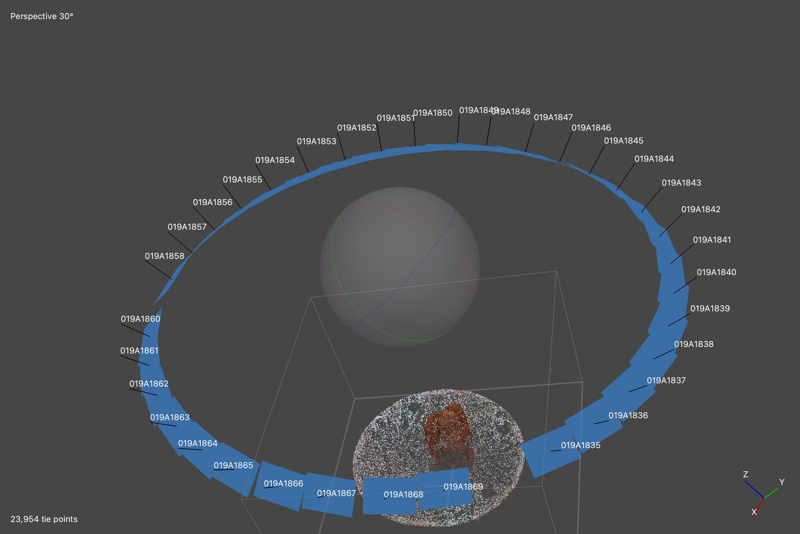
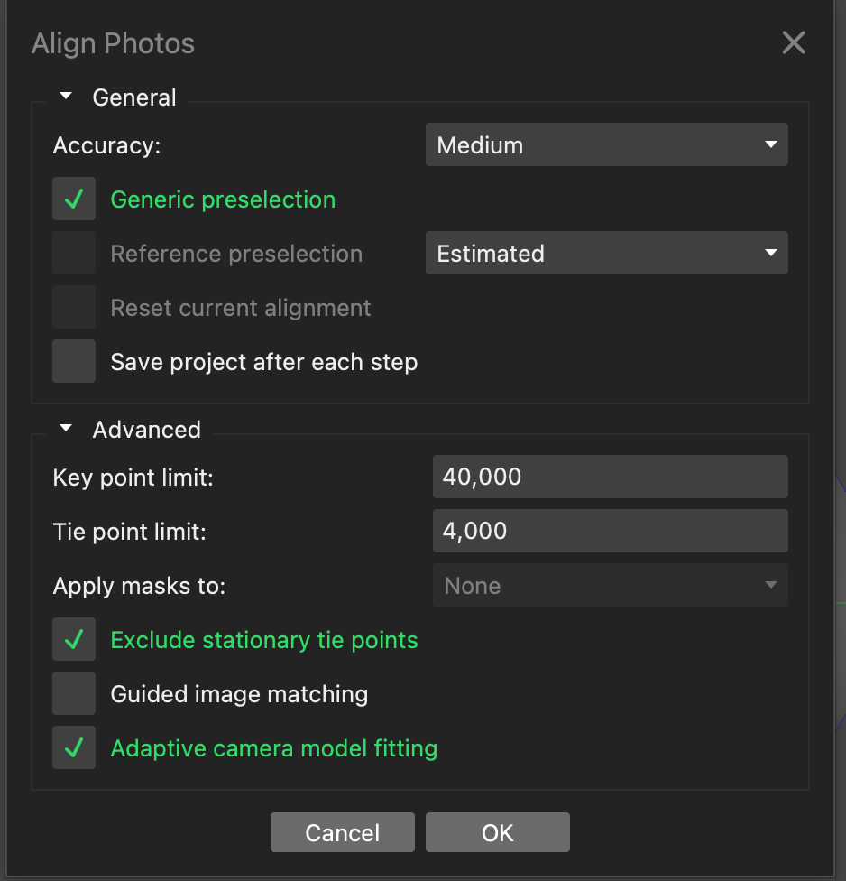
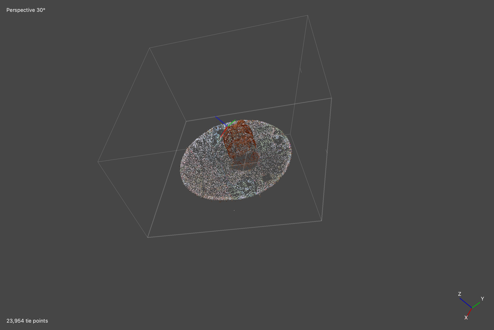
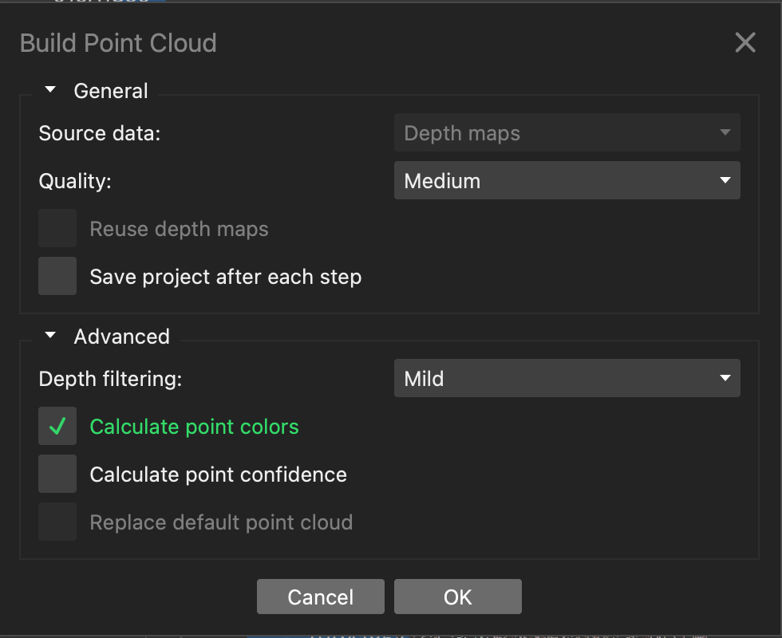
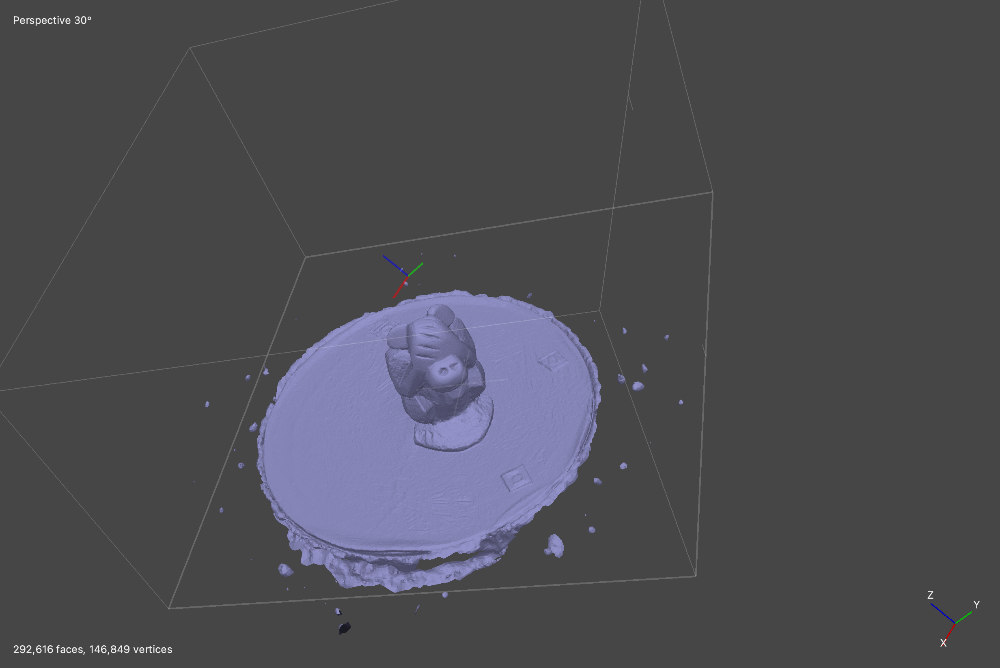
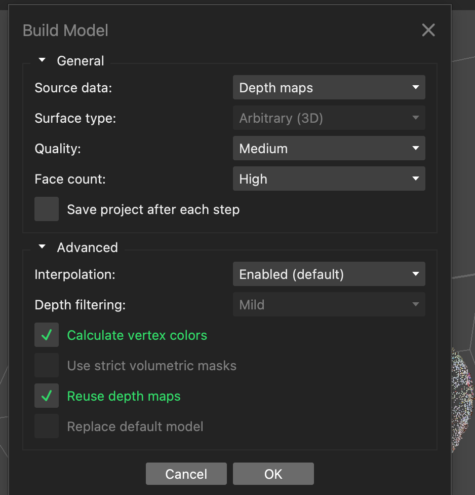
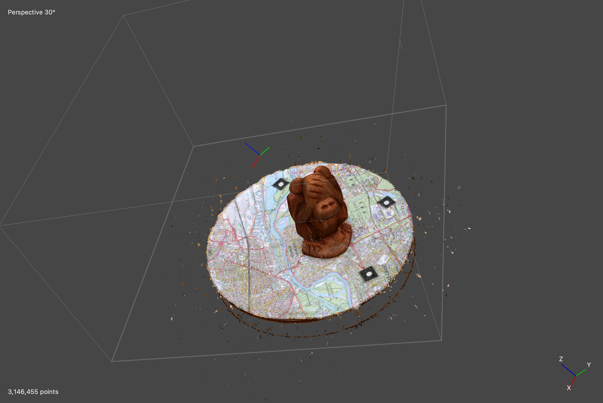
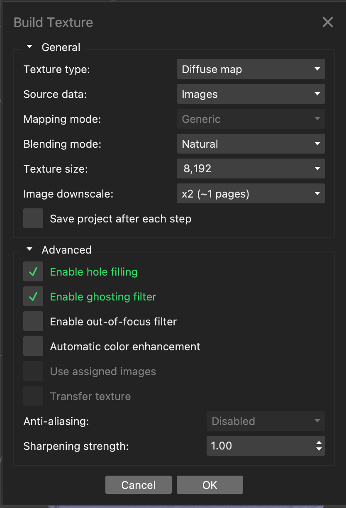

# 3D Reconstruction of a Wooden Figurine Using Photogrammetry

## 1. Project Overview

This project focuses on the 3D reconstruction of a wooden figurine using photogrammetry and Agisoft Metashape.

Photogrammetry is a technique that uses photographs taken from different viewpoints to reconstruct the three-dimensional shape of an object. By identifying common features across overlapping images, it is possible to estimate the object's geometry and create a 3D model.

The main objective of this project is to reconstruct a wooden figurine from a set of photographs and obtain a textured 3D model that represents both its shape and its visual appearance.

## 2. Methodology

The reconstruction process consists of several steps, performed using Agisoft Metashape.

### 2.1. Image Acquisition

A set of 34 photographs of a wooden figurine was used as input data. The images were taken from different viewpoints to capture the object's visible surfaces and provide overlapping visual information.

### 2.2. Photo Alignment

The photographs were aligned to estimate the camera positions and orientations. Metashape identified common visual features across the images and used them to estimate the spatial relationships between the cameras.

This step produced a sparse point cloud representing the main structure of the figurine.

### 2.3. Point Cloud Generation

A denser point cloud was generated using depth maps estimated from the aligned photographs. This representation provides more detailed information about the figurine's three-dimensional surface.

### 2.4. 3D Model Reconstruction

The point cloud and depth information were used to reconstruct the figurine's surface as a 3D model. This step represents the object's geometry in three dimensions.

### 2.5. Texture Generation

Finally, the original photographs were used to generate a texture for the 3D model. The texture adds color and visual details to the reconstructed surface, making the model look more similar to the original figurine.

## 3. Results

This section presents the main results obtained during the 3D reconstruction workflow using Agisoft Metashape.

### 3.1. Photo Alignment

The photographs were aligned to estimate the camera positions and orientations. This step also generated a sparse point cloud representing the main structure of the wooden figurine.

**Alignment result**



**Alignment parameters**



### 3.2. Point Cloud Generation

A denser point cloud was generated from depth maps calculated using the aligned photographs. It provides a more detailed representation of the figurine's surface.

**Point cloud result**



**Point cloud parameters**



### 3.3. 3D Model Reconstruction

The reconstruction process generated a 3D model representing the geometry of the wooden figurine.

**3D model result**



**Model reconstruction parameters**



### 3.4. Texture Generation

The original photographs were used to generate a texture for the reconstructed model, adding color and visual details to its surface.

**Textured model**



**Texture generation parameters**



## 4. Project Structure

The repository is organized into several directories to separate the input data, reconstruction project, results, and documentation.

```text
3D-Reconstruction-of-a-Wooden-Figurine-Using-Photogrammetry/
├── dataset/
│   └── Original photographs
├── project/
│   └── wooden_figurine.psx
├── results/
│   ├── images/
│   │   ├── aligne_point.png
│   │   ├── cloud_point.png
│   │   ├── model.png
│   │   ├── texture.png
│   │   ├── param_aligne_point.png
│   │   ├── para_cloud_point.png
│   │   ├── param_model.png
│   │   └── param_texture.png
│   │
│   └── models/
│       ├── model.obj
│       ├── model.mtl
│       └── model.jpg
├── report/
├── .gitignore
├── LICENSE
└── README.md
```

- **`dataset/`**: contains the original photographs used for reconstruction.
- **`project/`**: stores the Agisoft Metashape project file.
- **`results/images/`**: contains screenshots of the processing settings and reconstruction results.
- **`results/models/`**: is intended to store the exported 3D model.
- **`report/`**: is reserved for the project report.
- **`.gitignore`**: specifies files and directories that Git should ignore.

## 5. Outputs and Tools

### 5.1. Tools

- **Agisoft Metashape**: used for photo alignment, point cloud generation, 3D model reconstruction, and texture generation.

### 5.2. Outputs

- **Processing screenshots (`.png`)**: document the settings and results of each reconstruction stage.
- **Metashape project (`.psx`)**: stores the project for continuing the workflow in Metashape.
- **3D model (`model.obj`)**: contains the reconstructed 3D geometry.
- **Material file (`model.mtl`)**: defines the model material and references the texture.
- **Texture (`model.jpg`)**: provides the image used for the model's visual appearance.